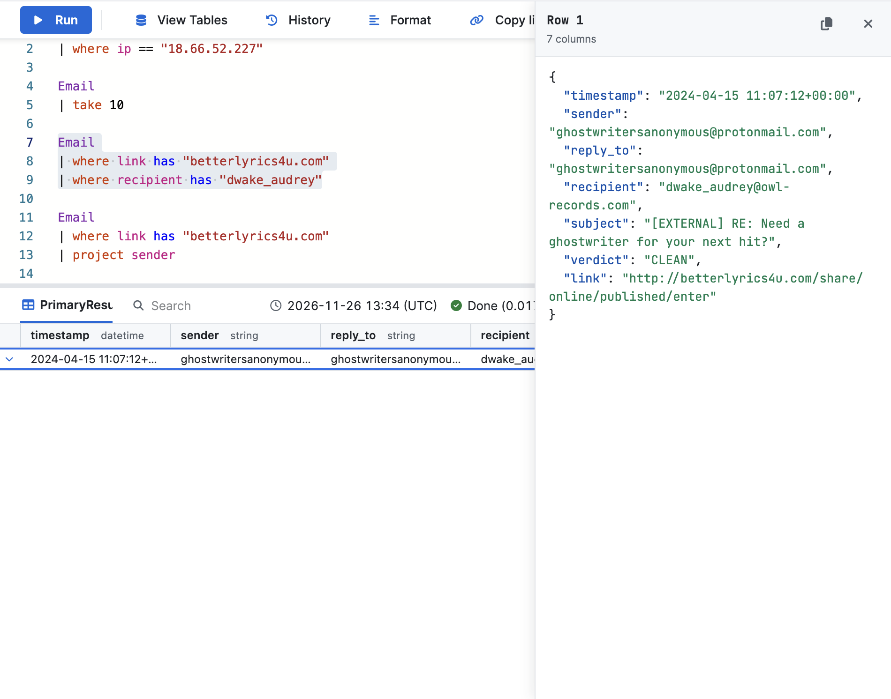

# Q12

**Pertanyaan:** What was the subject of the email sent to Dwake?

**Konteks:**
Balik lagi liat email phishing-nya, cari row yang recipient-nya Dwake.
```kql
Email
| where link has "betterlyrics4u.com"
```


**Cara penyelesaian:** Lihat kolom `subject` di row dengan recipient Dwake.

**Jawaban:** [EXTERNAL] RE: Need a ghostwriter for your next hit?
