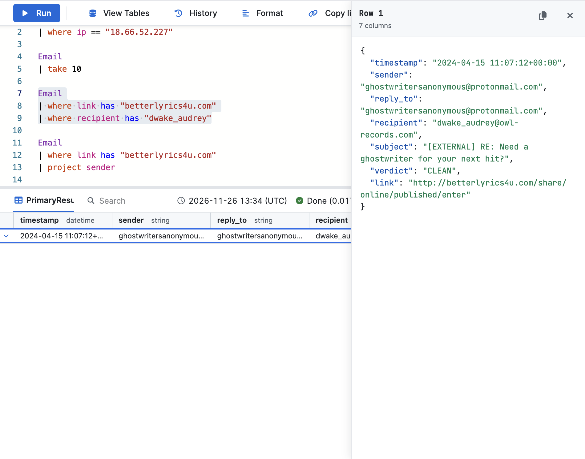

# Q13

**Pertanyaan:** What link did the adversaries include in their phishing email targeting Dwake?

**Konteks:**
Kemungkinan besar adversary mau Dwake klik link itu dan masukin credentials-nya (kena phishing/credential harvesting).

**Cara penyelesaian:** Lihat kolom `link` di row email yang sama kayak [Q12](./q12.md) (recipient Dwake).

**Jawaban:** http://betterlyrics4u.com/share/online/published/enter
