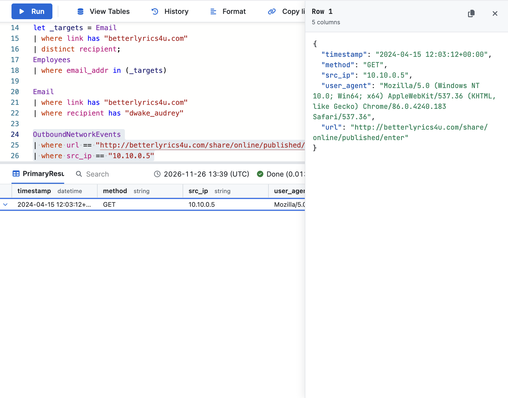

# Q16

**Pertanyaan:** When did Dwake click on the link in email? (copy and paste the time exactly)

**Konteks:**
Email security product ternyata gak nge-block, email-nya emang masuk ke inbox Dwake. Pertanyaannya: diklik gak? `OutboundNetworkEvents` nyatet setiap link yang diklik di network OWL Records, jadi kalau Dwake klik link phishing-nya, bakal kecatet di situ. Cek IP Dwake ([Q11](./q11.md): `10.10.0.5`) dan link phishing-nya ([Q13](./q13.md)).

**Cara penyelesaian:**
```kql
OutboundNetworkEvents
| where url == "http://betterlyrics4u.com/share/online/published/enter"
| where src_ip == "10.10.0.5"
```


**Jawaban:** 2024-04-15 12:03:12+00:00
