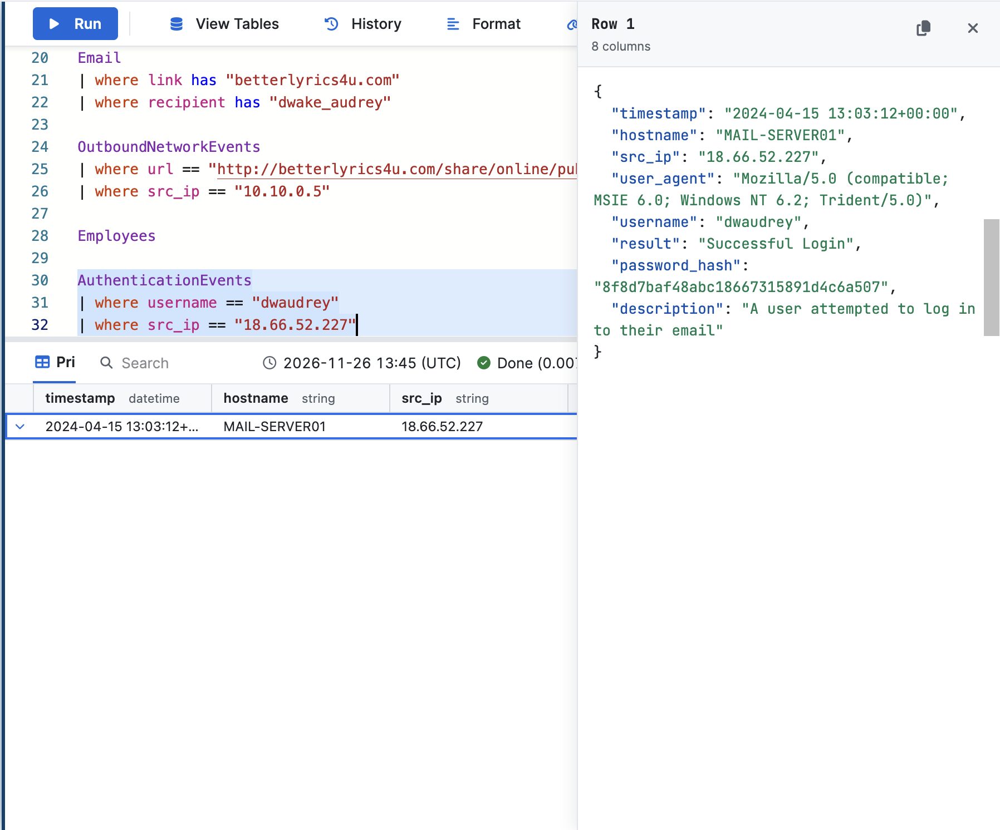

# Q18

**Pertanyaan:** When did the adversaries attempt to login to Dwake's account?

**Konteks:**
Setelah dapet credentials Dwake, adversary perlu validasi dengan beneran login ke akunnya. Cek `AuthenticationEvents` buat liat kalau adversary berhasil login.

**Cara penyelesaian:**
```kql
AuthenticationEvents
| where username == "dwaudrey"
| where src_ip == "18.66.52.227"
```


**Jawaban:** 2024-04-15 13:03:12+00:00
