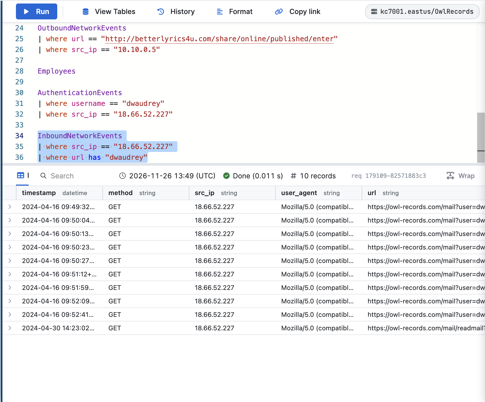

# Q20

**Pertanyaan:** How many results do we get?

**Konteks:**
Setelah berhasil login ke akun Dwake ([Q19](./q19.md)), adversary bakal cari info penting buat dicuri. Karena udah tau IP adversary, tinggal cek `InboundNetworkEvents` buat aktivitas ke akun Dwake.

**Cara penyelesaian:**
```kql
InboundNetworkEvents
| where timestamp between (datetime("2024-04-12T00:00:00") .. datetime("2024-05-01T00:00:00"))
| where url has "dwaudrey"
| where src_ip has "18.66.52.227"
```


**Jawaban:** 10
