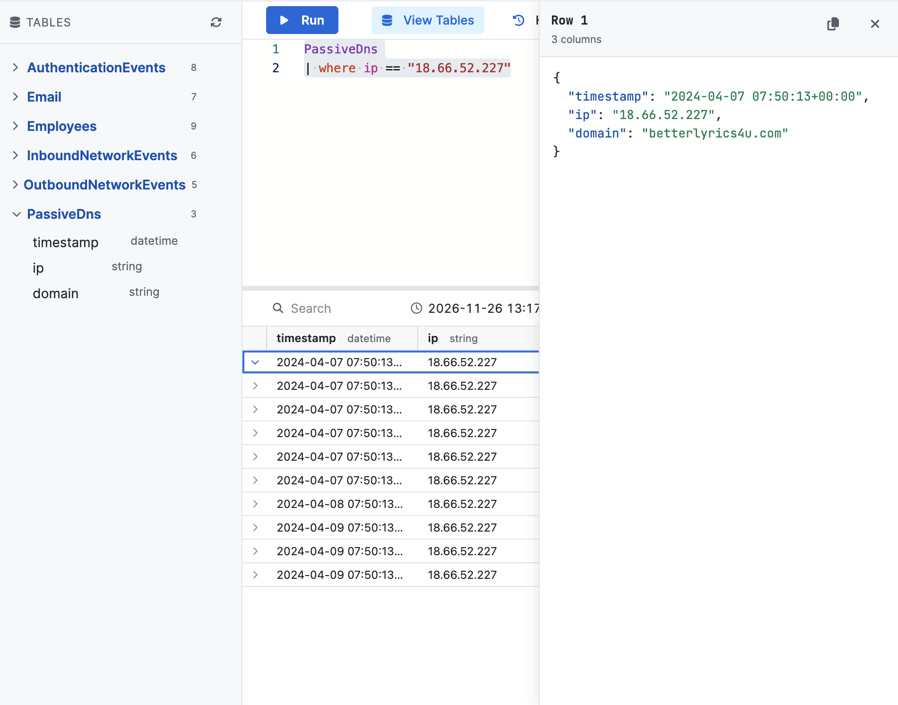

# Q3

**Pertanyaan:** What domain did IP 18.66.52.227 resolve to?

**Konteks:**
Mulai cari jejak phishing. Kita udah tau satu hal soal adversary: dia pake IP `18.66.52.227` di operasinya (sama kayak Section 1). Kalau nemu domain yang assosiasi ke IP ini, bisa ngarah ke phishing email-nya. Cek relasi IP<->domain di table `PassiveDns`.

**Cara penyelesaian:**
```kql
PassiveDns
| where ip == "18.66.52.227"
```


**Jawaban:** betterlyrics4u.com
