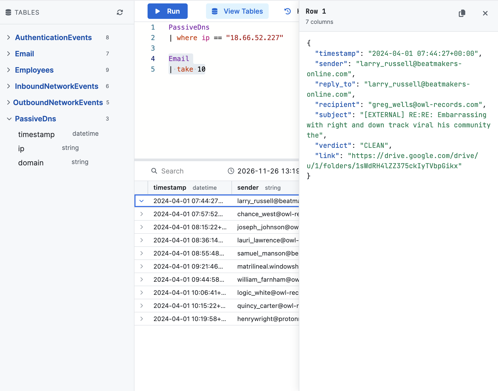

# Q4

**Pertanyaan:** Which column in the email table is most likely to contain the domain identified in the previous question?

**Konteks:**
Udah dapet domain (`betterlyrics4u.com`, lihat [Q3](./q3.md)). Sekarang cek email logs buat bukti domain itu dipake di phishing. Mulai kenalan sama table `Email` pake `take` buat liat 10 random row:
```kql
Email
| take 10
```


**Cara penyelesaian:** Dari kolom-kolom di table `Email`, yang paling masuk akal nyimpen domain/URL adalah kolom link.

**Jawaban:** link
