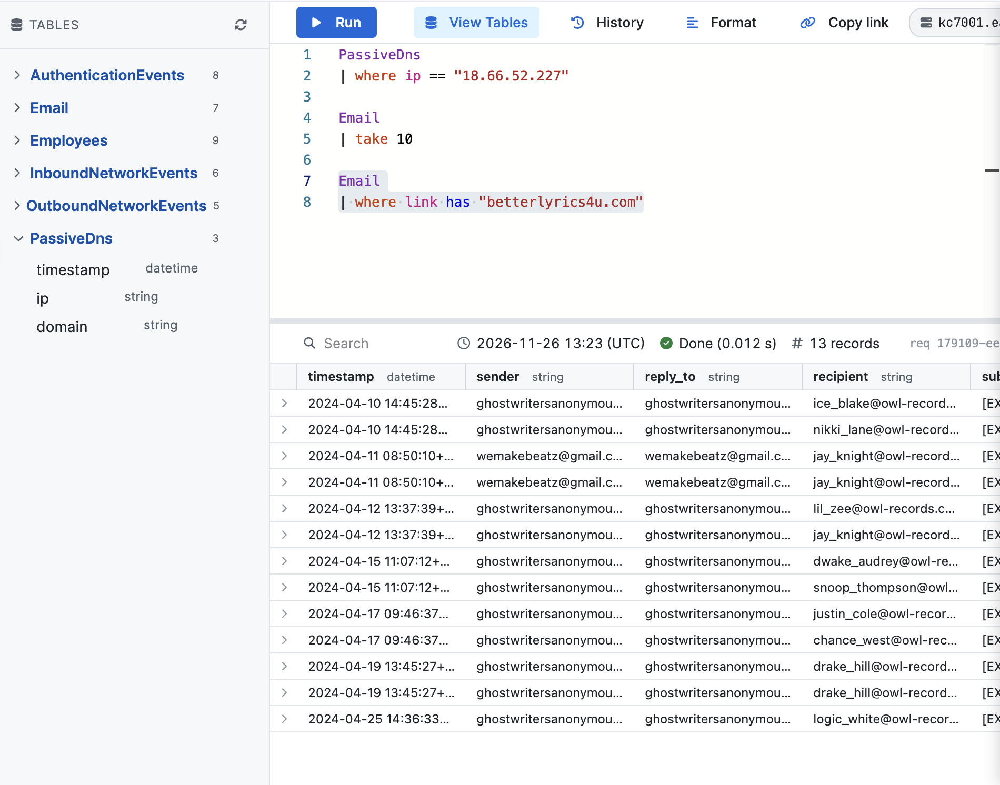

# Q5

**Pertanyaan:** How many results did we get from this query?

**Konteks:**
Lanjut dari [Q4](./q4.md) — sekarang filter kolom `link` buat cari domain `betterlyrics4u.com`.

**Cara penyelesaian:**
```kql
Email
| where link has "betterlyrics4u.com"
```


**Jawaban:** 13
