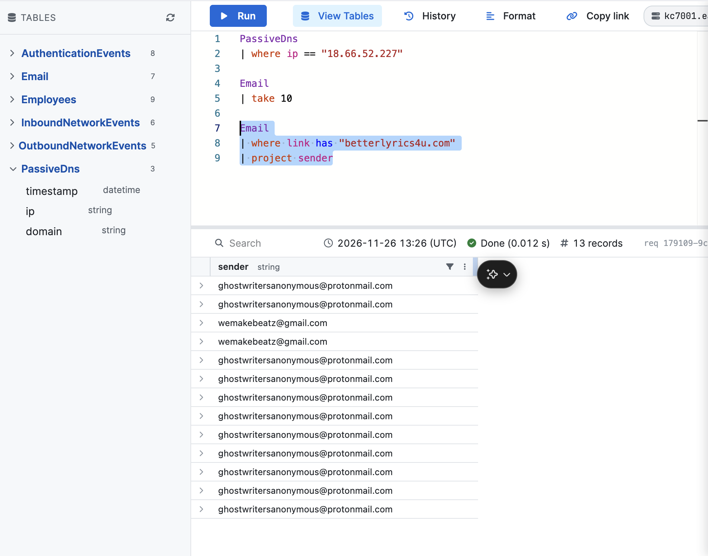

# Q6

**Pertanyaan:** Which email address was used to send most of these emails?

**Konteks:**
13 email (dari [Q5](./q5.md)) ini masing-masing dikirim ke seseorang di OWL Records — OWL Records kena phishing.

**Cara penyelesaian:** Pake query yang sama kayak Q5, liat kolom sender/from — cari email address yang paling sering muncul.
```kql
Email
| where link has "betterlyrics4u.com"
```


**Jawaban:** ghostwritersanonymous@protonmail.com
