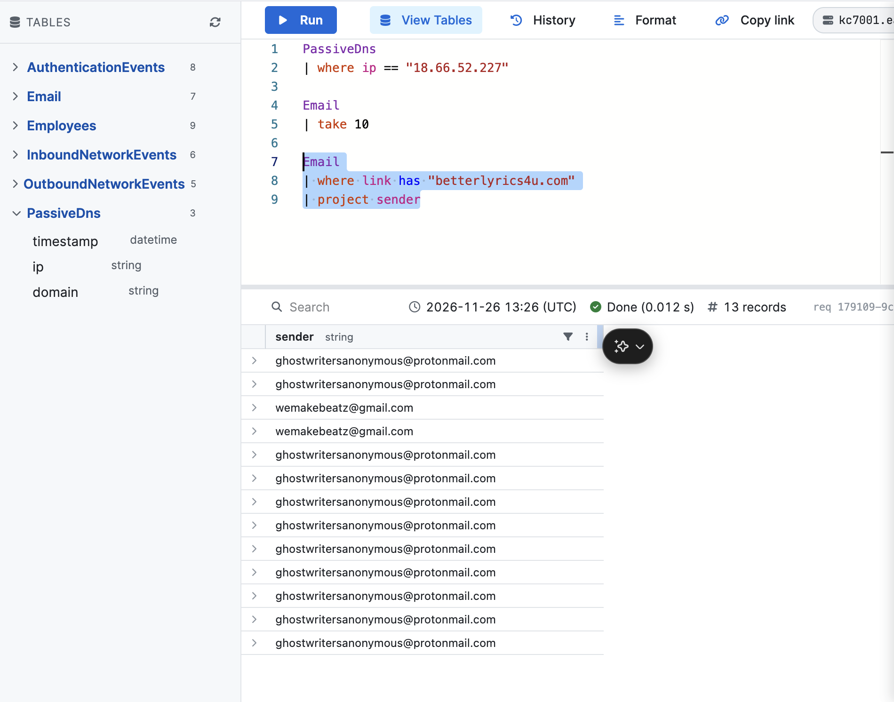

# Q7

**Pertanyaan:** What was the other email address used to send these phishing emails?

**Konteks:**
Masih dari hasil query yang sama kayak [Q6](./q6.md) — selain `ghostwritersanonymous@protonmail.com`, ada satu email address lain yang juga dipake buat kirim phishing.

**Cara penyelesaian:** Lihat lagi kolom sender dari hasil query `Email | where link has "betterlyrics4u.com"`, cari address kedua yang muncul.

**Jawaban:** wemakebeatz@gmail.com
