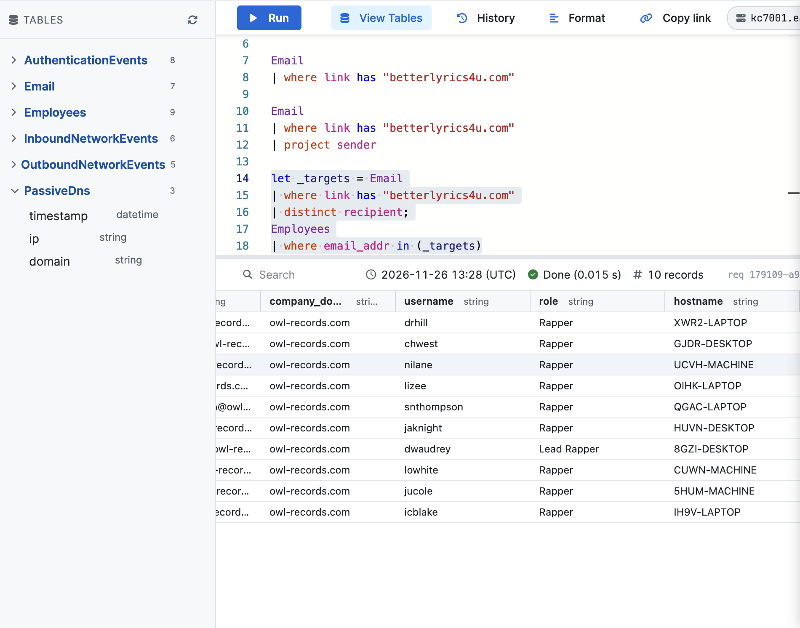

# Q8

**Pertanyaan:** Which role was targeted the most of all?

**Konteks:**
Adversary kayaknya ngincer user dengan role tertentu secara spesifik.

**Cara penyelesaian:**
```kql
let _targets = Email
| where link has "betterlyrics4u.com"
| distinct recipient;
Employees
| where email_addr in (_targets)
```
`let _targets = ...` bikin variabel dari hasil query (list recipient unik email phishing), lalu dipakai lagi buat filter `Employees` yang `email_addr`-nya ada di list itu — biar keliatan role apa yang paling banyak ditarget.


**Jawaban:** Rapper
